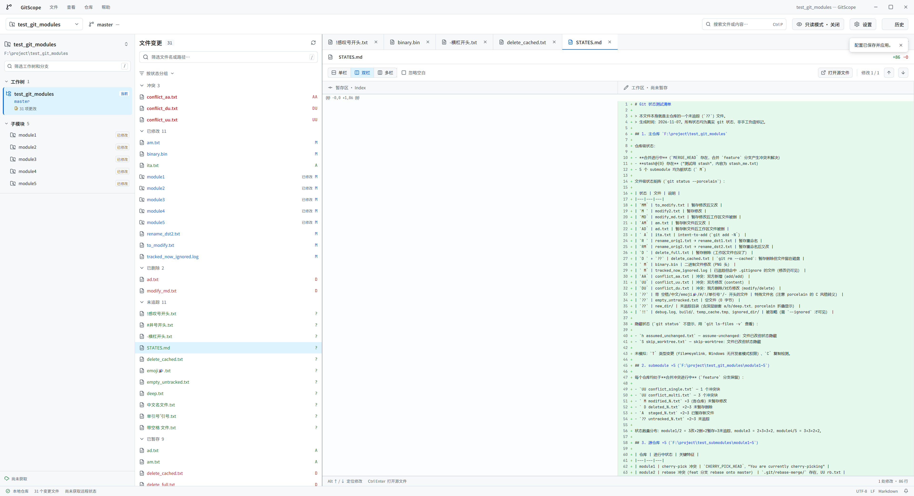

# GitViews

**GitViews 是一款面向代码阅读和变更审查的跨平台 Git 桌面工具。** 用它打开本地仓库，就能在同一个窗口查看文件状态、源码、Diff 和提交历史；需要管理仓库时，也可以开启 Git 写入功能。

它尤其适合经常查看 AI 生成代码、跨多个仓库审查改动，或希望先安全浏览再决定如何提交的开发者。

[访问官网](https://yclnycl.github.io/git-views-rust/) · [下载最新版本](https://github.com/yclnycl/git-views-rust/releases/latest) · [报告问题](https://github.com/yclnycl/git-views-rust/issues)

## 界面预览

下面是真实应用截图，展示包含多个子模块、冲突与文件变更的仓库。图片会随 GitHub 页面主题切换；也可以单独查看[深色模式](site/assets/gitviews-dark.png)或[浅色模式](site/assets/gitviews-light.png)原图。

<picture>
  <source media="(prefers-color-scheme: dark)" srcset="site/assets/gitviews-dark.png">
  <source media="(prefers-color-scheme: light)" srcset="site/assets/gitviews-light.png">
  
</picture>

## 设计理念

代码写完不代表审查结束。无论改动来自自己、队友还是 AI，理解哪些文件发生了变化、哪些内容已经暂存，以及变化属于哪个仓库，都是下一步操作的前提。GitViews 把仓库与工作树、文件状态、代码与 Diff 放在同一工作台，让你在熟悉上下文后再决定如何处理。

它以**只读浏览为起点，按需开启 Git 操作**：查看时减少误操作的机会，需要暂存、提交或同步时又不必离开当前上下文。面对带子模块的项目，父仓库与子模块各自的状态和历史也保持清晰的边界。

## 为什么使用 GitViews

- **先看清，再操作**：默认以只读模式打开仓库，集中查看变更、Diff、源码、搜索和历史；需要提交或同步时可随时开启高级功能。
- **为代码审查而设计**：暂存与未暂存内容分开展示，支持单双栏 Diff、语法高亮、文件历史、多标签和内容搜索，不需要依赖外部编辑器预览。
- **照顾真实项目结构**：在多个仓库、工作树和子模块之间切换，查看各自的分支、文件变化和历史。
- **按需要选择 Git 方案**：内置 Git 可独立使用；需要团队已有的 hooks、提交签名或凭据助手时，可选择本地 Git。
- **关注大型列表的交互体验**：仓库读取、搜索和差异解析在后台执行，长列表按可见范围绘制，并对缓存及单次搜索设置预算。

## 下载与运行

前往 [GitHub Releases](https://github.com/yclnycl/git-views-rust/releases/latest)，下载适合你的系统和处理器的压缩包，解压后运行：

| 平台 | 文件 | 启动方式与要求 |
| --- | --- | --- |
| Windows x64 | `GitViews-windows-x64.zip` | 运行 `GitViews.exe`。支持 Windows 10 1803 及更新版本或 Windows 11，需要兼容 Direct3D 11 的显卡与驱动。 |
| Linux x64 | `GitViews-linux-x64.tar.gz` | 运行解压目录中的 `./gitviews`。基于 Ubuntu 24.04 构建，需要兼容的系统动态库、Wayland 或 X11 图形会话及可用的 Vulkan 驱动。缺库时可用 `ldd ./gitviews` 排查。 |
| macOS Apple 芯片 | `GitViews-macos-arm64.tar.gz` | 打开解压后的 `GitViews.app`。 |
| macOS Intel 芯片 | `GitViews-macos-x64.tar.gz` | 打开解压后的 `GitViews.app`。 |

每个发布包都附有对应的 SHA-256 校验文件。macOS 包目前未经过 Apple Developer ID 签名或公证，首次打开时可能被 Gatekeeper 拦截。Linux 和 macOS 已在 CI 中构建与测试，但不代表已验证所有桌面环境。

## 开始使用

1. 启动 GitViews，打开本地 Git 仓库；可以继续添加其他仓库并在它们之间切换。
2. 在文件列表选择变更，查看暂存区或工作区的 Diff；也可以打开源码、搜索内容或查看提交历史。
3. 如果要暂存、提交、切换分支或同步远端，在工具栏、**查看**菜单或设置中关闭只读模式，首次开启时选择内置 Git 或本地 Git。

只读模式限制对仓库的写入；应用仍会保存自身设置、仓库列表和日志。内置 Git 不执行 hooks，也不创建签名提交；如果工作流依赖这些功能，请选择本地 Git，并确保本机 Git 与相关凭据、签名工具已配置好。

## 功能一览

### 只读浏览与代码审查

- **只读模式**：新安装默认开启，可浏览仓库、工作树、子模块、文件状态、Diff、源码、搜索和历史。暂存、提交、分支管理、远端同步等写入入口会收起，相应快捷键也会被拦截。关闭只读模式后可使用高级操作，之后也能随时切回。
- **读懂每处变更**：按状态分组或文件树浏览变更，区分冲突、修改、删除和未追踪文件；在暂存区与工作区之间切换，使用单栏或双栏 Diff 查看修改，支持多标签和语法高亮。
- **定位代码与历史**：按路径或内容搜索，支持正则、目录和类型筛选；查看文件历史、多分支提交图、版本比较和逐行归属。预览和搜索设置了文件大小、数量及时间预算，超限或覆盖不完整时会在界面提示。

只读模式约束对仓库的写入，应用仍会保存自身设置、仓库列表和日志。它不能阻止其他程序修改仓库；切换模式时，正在执行的 Git 操作需先完成。

### Submodule 与 Worktree

- **查看子模块**：主仓库中可查看子模块是否已初始化或存在修改。进入已初始化子模块后，可以在其自身范围查看文件、分支和历史，也可选择在搜索中包含已初始化子模块。
- **理解父子仓库的边界**：父仓库记录的是子模块的 gitlink 提交位置；子模块内部改动需要进入子模块查看和处理。子模块提交后，父仓库中的 gitlink 更新仍需单独暂存和提交。未初始化的子模块会保留条目，但需先初始化才能进入或切换分支。
- **管理工作树**：在关联工作树之间切换，或在高级模式下创建、锁定、解锁及移除工作树；涉及未提交内容、占用中的分支等情况时，操作会进行保护检查。

### 按需管理 Git

关闭只读模式后，可进行文件或修改块暂存、提交、储藏、分支管理、获取、快进拉取与推送，也支持合并、普通变基和冲突处理。内置 Git 便于独立使用；选择本地 Git 可以使用已有的 hooks、提交签名和凭据助手。支持范围与限制详见 [Git 状态支持明细](docs/GIT_STATUS_SUPPORT.md)。

### 界面与响应

应用支持浅色、深色和跟随系统主题，三栏宽度可调整，并可设置字号、刷新和缓存。仓库读取、搜索与 Diff 解析在后台执行，长列表按可见范围绘制；切换上下文时会停止过期请求或丢弃过期结果，帮助保持交互流畅。实际体验仍会随仓库规模、文件内容和设备变化。

## 性能测试

以下是仓库中保留的 **2026-11-08 Windows 历史版本本机基线**，并非当前版本的实测、速度承诺或与其他软件的对比。测试机器为 Intel Core i7-10700、约 32 GiB 内存；使用合成的本地仓库，各进行 3 次桌面进程隐藏启动。

| 已跟踪文件数 | 启动到仓库模型就绪，中位数 | 空闲工作集，中位数 |
| ---: | ---: | ---: |
| 100 | 680 ms | 105 MiB |
| 1,000 | 704 ms | 105 MiB |
| 10,000 | 879 ms | 108 MiB |

“模型就绪”表示仓库数据已应用到界面模型，**不等于 GPU 首帧已经显示**；测试未清空操作系统文件缓存，结果会随机器、仓库和系统状态变化。空闲工作集是进程驻留内存的观测值，不包括 GPU 显存。

当时的服务层基线还测量了默认内容搜索：面对 10,100 个候选文件时，7 次查询都在约 3 秒的默认预算内返回了部分结果，而非完整遍历。此后内容搜索实现已有修改，不能将该记录当作当前版本的实测结果。可通过缩小搜索范围获得更聚焦的结果。

测试方法、p95、完整性说明、服务层测量和原始 JSON 见[性能与内存基线](docs/PERFORMANCE_BASELINE.md)。

## 从源码运行

项目使用 Rust、GPUI Kit 和 git2；工具链版本以 [`rust-toolchain.toml`](rust-toolchain.toml) 为准。安装 Rust 及对应平台的原生构建依赖后，在仓库根目录执行：

```sh
cargo run
```

平台依赖和更完整的开发、验证说明见[原 README 存档](docs/README-archive-2026-11-08.md)以及 [GPUI Kit 安装文档](https://gpui-kit.com/docs/installation/)。原 README 按原内容备份，其中相对路径以仓库根目录为基准。

## 更多资料

- [性能测试方法和原始数据](docs/PERFORMANCE_BASELINE.md)
- [Git 状态支持明细](docs/GIT_STATUS_SUPPORT.md)
- [项目架构](docs/architecture.md)
- [迭代记录](docs/ITERATIONS.md)
- [原 README 存档](docs/README-archive-2026-11-08.md)（原样保存；存档内相对链接可能需要从仓库根目录访问）

发布包中包含第三方许可材料；应用内许可界面目前展示 Windows 版本的清单。
